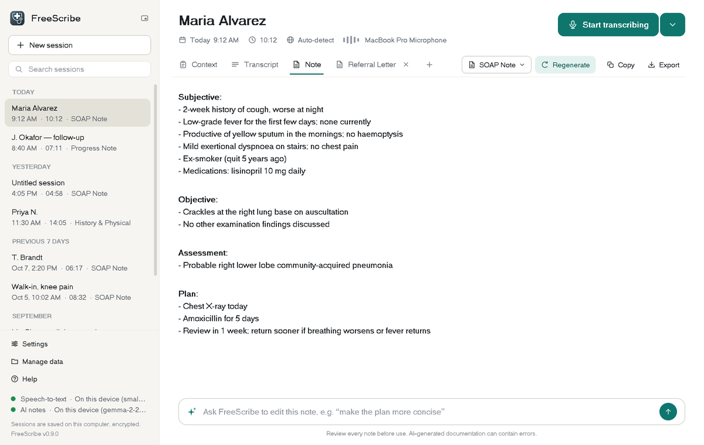

# FreeScribe

  

> **About this fork.** This is a fork of [ClinicianFOCUS/FreeScribe](https://github.com/ClinicianFOCUS/FreeScribe), based on its `dev` branch. It adds a redesigned workspace, PDF form filling and a built-in OSCAR eForm mapper (described below). It is not an official FreeScribe release; for those, see the [ClinicianFOCUS releases](https://github.com/ClinicianFOCUS/FreeScribe/releases).

## Download (one-click installers)

| Computer | Installer |
|---|---|
| Mac with Apple chip (M1–M4) | [FreeScribeInstaller_arm64.pkg](https://github.com/rmontaz/FreeScribe/releases/download/v1.2.1-RC1-workspace/FreeScribeInstaller_arm64.pkg) |
| Mac with Intel chip | [FreeScribeInstaller_x86_64.pkg](https://github.com/rmontaz/FreeScribe/releases/download/v1.2.1-RC1-workspace/FreeScribeInstaller_x86_64.pkg) |
| Windows (CPU, any PC) | coming soon |
| Windows (NVIDIA graphics card) | coming soon |
| Linux (x86_64) | [FreeScribe_linux_x86_64.tar.gz](https://github.com/rmontaz/FreeScribe/releases/download/v1.2.1-RC1-workspace/FreeScribe_linux_x86_64.tar.gz): unpack, then run `./run-freescribe.sh` |

All files are on the [release page](https://github.com/rmontaz/FreeScribe/releases/tag/v1.2.1-RC1-workspace). The installers are not code-signed, so the first time you open one:

- **Mac:** if macOS blocks it, open **System Settings → Privacy & Security** and click **Open Anyway**.

## What's new in this fork

- **Session workspace.** A sidebar keeps every visit (searchable, grouped by day). Each session has a header with title, timer, microphone picker and level meter, and **Context / Transcript / Note** tabs. Context typed by the clinician is sent along with the transcript.
- **Note templates and a default.** SOAP, History & Physical, Progress Note, Referral Letter, a plain-language Patient Summary and No Note Generation are built in, with Brief / Standard / Detailed levels of detail. **Template → Make "…" the default** sets the note written automatically when transcription stops.
- **Documents and edits.** The **+** next to the tabs creates extra documents (such as a referral letter) from the same session. The bar at the bottom revises the note in plain words ("make the plan more concise"). Copy any tab or export it to Word, PDF or text.
- **Fill PDF form** (sidebar). Fills a PDF form from the session's note, transcript and context, then shows every field for review before saving a new copy. It works with fillable PDFs and with flat ones (printed or typed forms), where it finds the lines, boxes, table cells and tick boxes itself. Identifiers are replaced with placeholders before anything is sent to the AI and put back afterwards.
- **Chat** (sidebar). Chat with the AI about the open session. Every message is sent with the session's context, transcript, note, documents and the forms filled in it (each saved form is recorded in the chat with the values entered), and the conversation is kept with the session. Identifiers are replaced with placeholders the same way as for forms.
- **eForm mapper** (sidebar). Opens the OSCAR eForm Mapper in your browser. Its **Find fields from PDF** button places every field and checkbox exactly where the source PDF draws them, names them from their labels, and adds the obvious OSCAR tags (patient name, date of birth, health card number, today's date, physician, clinic). It runs only on your computer.
- **Transcribe Only Mode** and the **No Note Generation** template record and transcribe without writing a note.
- **Compact recorder.** A small always-on-top bar with record, pause, timer and level.
- **Third-party licences** are listed under **Help → Third-party licences**.

## Introduction

This is a application maintained extension of Dr. Braedon Hendy's AI-Scribe python script. It is maintained by the ClinicianFOCUS team at the Conestoga College SMART Center. The goal of this project is to have a easy to install Medical Scribe application. This application can run locally on your machine (No potential share of personal health data) or can connect to a Large Language Model (LLM) and Whisper (Speech2Text) Server on your network or to a remote one like ChatGPT. To download head over to our latest [releases](https://github.com/ClinicianFOCUS/FreeScribe/releases).

Please note this application is still in alpha state. Feel free to contribute, connect, or inquire in our discord where majority of project communications occur. https://discord.gg/zpQTGVEVbH

### Note from the original creator and active contributor Dr. Braedon Hendy:

> This is a script that I worked on to help empower physicians to alleviate the burden of documentation by utilizing a medical scribe to create SOAP notes. Expensive solutions could potentially share personal health information with their cloud-based operations. The application can then be used by physicians on their device to record patient-physician conversations after a signed consent is obtained and process the result into a SOAP note.
>
> Regards,
> Braedon Hendy

## Interface

- **Sessions** - every visit is kept in the sidebar with its transcript, context, note and documents. Search, rename or delete them; they are stored encrypted if you turn on local storage in the settings.
- **Start transcribing** - one button (Alt+R) records and transcribes the visit and then writes the note. Pause with Alt+P, upload an audio file instead, or resume an earlier session.
- **Context, Transcript, Note** - add anything that was not said aloud under Context, check the transcript, and edit the note directly.
- **Templates and documents** - SOAP, History & Physical, Progress Note, Referral Letter and a plain-language Patient Summary are built in, and you can add your own and choose which one is the default. The "+" next to the tabs creates further documents from the same session.
- **Chat, Fill PDF form and eForm mapper** - all are in the sidebar (see [What's new in this fork](#whats-new-in-this-fork)).
- **Ask for edits** - describe a change in the bar at the bottom ("make the plan more concise") and undo it if needed.
- **Copy and export** - copy any tab, or save it as a Word, PDF or text file.
- **Compact recorder** - a small always-on-top bar with record, pause, timer and microphone level.

## Setup on a Local Machine

To run the application on your machine just download the latest [release](https://github.com/ClinicianFOCUS/FreeScribe/releases), run the installer, and begin to use. The application is configured to run completely locally by default.

## Setup on a Server

If you would like to run the application on a local higher performance server please refer to our other tools.

- Local LLM Container: https://github.com/ClinicianFOCUS/local-llm-container
- Local Whisper Container: https://github.com/ClinicianFOCUS/speech2text-container
- All-in-one installer for the tools: https://github.com/ClinicianFOCUS/clinicianfocus-installer

# Further Documentation

Further documentation can be found [here](https://clinicianfocus.github.io/FreeScribe) (https://clinicianfocus.github.io/FreeScribe).

## Contributing

We welcome contributions to the FreeScribe project! To contribute:

1. Fork the [repository](https://github.com/ClinicianFOCUS/FreeScribe).
2. Create a new branch (`git checkout -b feature/your-feature`).
3. Make your changes and commit them (`git commit -m 'Add some feature'`).
4. Push to the branch (`git push origin feature/your-feature`).
5. Open a pull request.

Please ensure your code adheres to our coding standards and includes appropriate tests.

Tests run with `pytest` from the repository root. The interface tests in `tests/ui` need a display; on a headless Linux machine run them with `xvfb-run -a pytest tests/ui`.

# License

FreeScribes code is under the AGPL-3.0 License. See (LICENSE)[https://github.com/ClinicianFOCUS/FreeScribe/blob/main/LICENSE.txt] for further information.

Third-party libraries keep their own licences. The notices for the libraries used by PDF form filling (pypdf and PyMuPDF) are in [src/FreeScribe.client/markdown/help/third_party_notices.md](src/FreeScribe.client/markdown/help/third_party_notices.md), which is also shown in the app under **Help ▸ Third-party licences**.
